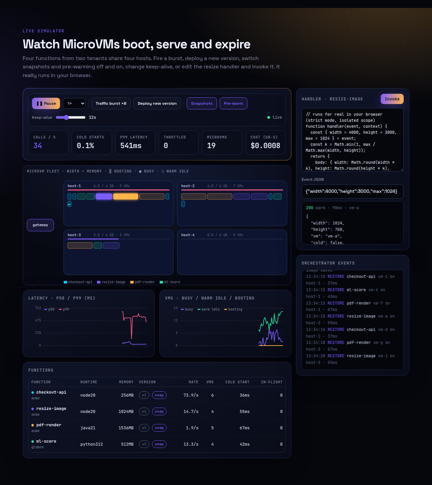
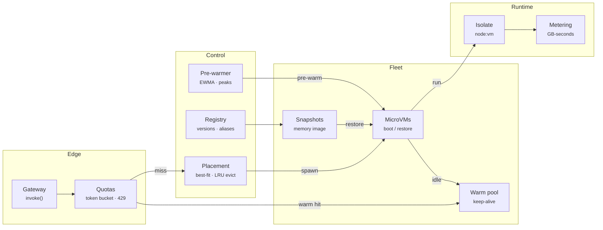
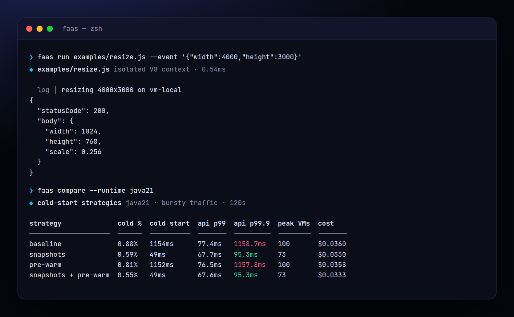
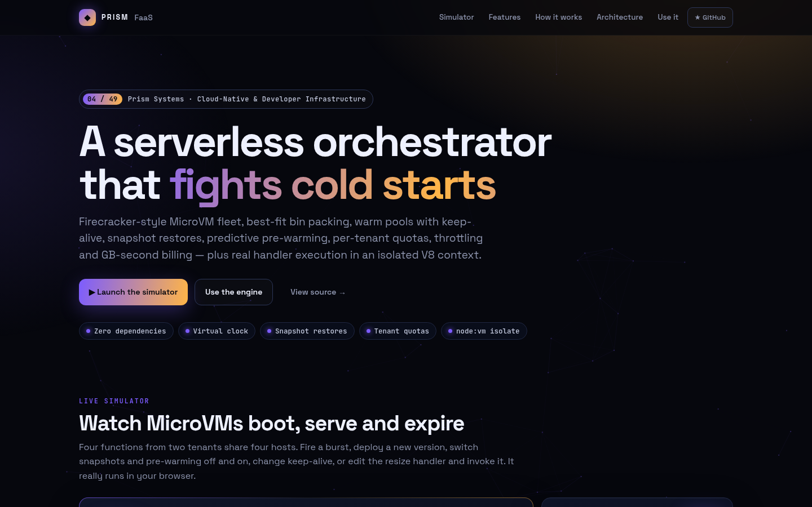
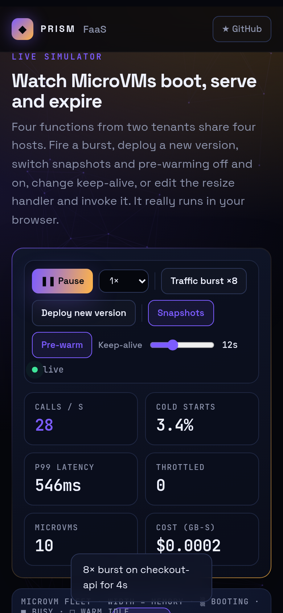

<!-- Prism Systems 04/49 -->
<p align="center">
  
</p>

<p align="center">
  
</p>

<p align="center">
  <a href="https://github.com/krishyaa06/prism-faas/actions/workflows/ci.yml"></a>
  <a href="https://krishyaa06.github.io/prism-faas/"></a>
  
  
  
  <a href="LICENSE"></a>
</p>

<p align="center">
  <a href="https://krishyaa06.github.io/prism-faas/"><b>Live simulator</b></a> ·
  <a href="docs/ARCHITECTURE.md"><b>Architecture</b></a> ·
  <a href="docs/USAGE.md"><b>Docs</b></a> ·
  <a href="#-quick-start"><b>Quick start</b></a>
</p>

<p align="center">
  <a href="https://krishyaa06.github.io/prism-faas/"></a>
</p>


## ⚡ Overview

Serverless platforms live or die by cold starts. Every request that misses a warm sandbox pays for a VM boot, runtime init and code load. Prism FaaS models the moving parts that AWS Lambda, Fly Machines and Cloud Run tune: where sandboxes are placed, how long they stay warm, when to restore from a snapshot instead of booting, how to pre-warm ahead of traffic, and how to protect tenants from each other.

## ✨ Features

| | Feature | Details |
| :-: | --- | --- |
| λ | **Function registry** | Versioned deploys with aliases. A new version drains old VMs: idle ones stop at once, busy ones finish first. |
| ▦ | **Best-fit bin packing** | MicroVMs go to the host with the least leftover memory that still fits. When full, the least recently used idle VM is evicted. |
| ♨ | **Warm pools** | Idle VMs stay warm for `keepAlive` seconds. Warm hits reuse the most recently used VM, so the pool shrinks naturally. |
| ❄ | **Cold start model** | VM boot + runtime init (`node20`, `python312`, `java21`) + code size + memory, compared with snapshot restore. |
| 📸 | **Snapshot restores** | After deploy, a memory snapshot is taken. Cold starts become restores, roughly 1.1s → 50ms for Java. |
| 📈 | **Predictive pre-warm** | EWMA arrival rate, a decaying peak memory and measured service time size a warm pool ahead of recurring bursts. |
| ⛔ | **Quotas and throttling** | Tenant token buckets, tenant/function/account concurrency limits, all returning `429` with the reason. |
| 🔒 | **Real isolation** | `runIsolated()` executes handlers in a fresh `node:vm` context with a CPU timeout and string code generation disabled. |

## 🏗️ Architecture



### How it works

1. **Deploy** — Register a function with runtime, memory, timeout and concurrency. A snapshot of the initialised VM is captured shortly after.
2. **Route** — Each invocation passes the tenant rate limiter and three concurrency gates, then looks for a warm idle VM of the current version.
3. **Start** — With no warm VM, the orchestrator places a new MicroVM best-fit (evicting LRU idle VMs if needed) and pays a cold or restore start.
4. **Execute** — The handler runs with `(event, context)`. Duration is capped by the timeout (504), and exceptions become 500s.
5. **Scale** — Every 500ms, keep-alive expiry reclaims idle VMs and the predictor tops up the warm pool from the arrival rate and peaks.

More detail in [docs/ARCHITECTURE.md](docs/ARCHITECTURE.md).

## 🚀 Quick Start

**Try it in the browser:** [https://krishyaa06.github.io/prism-faas/](https://krishyaa06.github.io/prism-faas/), no install needed.

```bash
# CLI, no install
npx github:krishyaa06/prism-faas --help

# add the engine to a project
npm install github:krishyaa06/prism-faas
```

### JavaScript API

```js
import { Platform, compile } from "prism-faas";

const p = new Platform({ hosts: 4, hostMem: 8192, keepAlive: 30, snapshots: true });
p.tenant("acme", { concurrency: 100, rps: 500 });

p.deploy({
  name: "resize", tenant: "acme", runtime: "node20", memory: 1024, timeout: 10,
  handler: compile(`function handler(e) { return { body: { ok: true, w: e.w / 2 } } }`),
});

p.invoke("resize", { w: 4000 }, (r) => console.log(r.status, r.kind, r.result));
p.advance(2);                       // virtual seconds
console.log(p.stats, p.percentile(0.99));

// Node: real isolation with a CPU timeout
import { runIsolated } from "prism-faas/src/node/vm-runner.js";
runIsolated(source, { w: 4000 }, { timeoutMs: 500 });
```

| Export | What it does |
|---|---|
| `new Platform({ hosts, hostMem, keepAlive, snapshots, prewarm, accountConcurrency, seed })` | Orchestrator on a virtual clock |
| `platform.tenant(name, { concurrency, rps })` | Tenant quotas |
| `platform.deploy({ name, tenant, runtime, memory, timeout, reserved, maxConcurrency, handler })` | Register a new version |
| `platform.invoke(name, event, cb)` | `cb({ status, latency, kind: cold/restored/warm, vm, result })` |
| `platform.advance(dt)` | Advance virtual time |
| `platform.coldStart(fn)` · `percentile(p, since, fn)` · `utilization()` · `stats` | Metrics |
| `compile(source)` | Browser-safe handler compiler |
| `runIsolated(source, event, { timeoutMs })` | Node-only `node:vm` isolate (`src/node/vm-runner.js`) |

### CLI

```bash
$ npx github:krishyaa06/prism-faas run examples/resize.js --event '{"width":4000,"height":3000}'
$ npx github:krishyaa06/prism-faas load --rps 120 --seconds 60 --runtime java21
$ npx github:krishyaa06/prism-faas load --no-snapshots --no-prewarm
$ npx github:krishyaa06/prism-faas compare --runtime java21
```

<p align="center"></p>

| Command | Description |
|---|---|
| `faas run <handler.js> [--event json] [--timeout ms]` | Execute a handler in an isolated context |
| `faas load [--rps] [--seconds] [--runtime] [--memory] [--no-snapshots] [--no-prewarm]` | Bursty load test with latency, cold starts and cost |
| `faas compare [--runtime]` | Baseline vs snapshots vs pre-warm |

## 📸 Screenshots

<table>
  <tr>
    <td width="68%"></td>
    <td width="32%"></td>
  </tr>
</table>

## 🧠 Design Decisions

- **Event-driven virtual clock.** A timer heap drives boots, executions and expiries, so a minute of bursty traffic simulates in milliseconds and tests are deterministic.
- **MRU reuse, LRU eviction.** Reusing the most recently used warm VM concentrates load and lets the rest expire. Evicting the least recently used idle VM frees memory with the least expected loss.
- **Best-fit packing** keeps large holes open for big functions (a 1.5 GB Java VM) instead of fragmenting every host.
- **Predictive pool sizing** uses Little's law (concurrency ≈ arrival rate × service time) on a decaying peak rate, so recurring bursts land on warm VMs.
- **Isolation by default.** The Node runner disables `eval` and `new Function` inside the sandbox and enforces a CPU timeout.

## 🏭 Production Notes

This is a faithful control-plane model, not a hypervisor. To make it real:

- Replace `spawn()` with Firecracker's API (`PUT /machine-config`, `/boot-source`, `/actions`) or Fly Machines/Cloud Run, and `restore` with Firecracker snapshot load.
- Put the router behind a real HTTP gateway and keep warm-pool state in Redis for multi-node control planes.
- Use cgroups/seccomp in each MicroVM. `node:vm` is a convenience isolate, not a security boundary against hostile code.
- Export GB-second metering to your billing pipeline.

## 📁 Project Structure

```text
prism-faas/
├── assets/
│   └── logo.svg
├── bin/
│   └── faas.js
├── css/
│   └── app.css
├── docs/
│   ├── ARCHITECTURE.md
│   └── USAGE.md
├── examples/
│   └── resize.js
├── js/
│   └── app.js
├── src/
│   ├── lib/
│   │   ├── cli.js
│   │   ├── heap.js
│   │   └── rng.js
│   ├── node/
│   │   └── vm-runner.js
│   ├── index.js
│   └── platform.js
├── test/
│   └── faas.test.js
├── .gitignore
├── LICENSE
├── README.md
├── index.html
└── package.json
```

## 🧪 Tests

```bash
npm test
```

The test suite uses the built-in `node:test` runner, so there is nothing to install. CI runs it on Node 20 and 22.

## 🗺️ Roadmap

- [ ] Firecracker driver behind the same interface
- [ ] Async invocations with a durable queue + DLQ
- [ ] Provisioned concurrency schedules
- [ ] Per-tenant cost dashboards

## 🤝 Contributing

1. Fork the repo and create a branch: `git checkout -b feat/my-idea`
2. Make your change in `src/` and add a test in `test/`
3. Run `npm test`, then open a Pull Request

## 🔷 Part of Prism Systems

**Prism FaaS** is system **04 of 49** in **Prism Systems**, a series of open-source reference implementations of large-scale infrastructure by [Prism Protocol](https://dc.gg/prismprotocol). Each one ships a real engine, a CLI and a live simulator, all with zero dependencies.

## 👤 Author

<table>
  <tr>
    <td align="center">
      <a href="https://github.com/krishyaa06"><br><b>Soumya Bhandare</b></a><br>
      <sub>Founder @ Prism Protocol</sub>
    </td>
    <td>
      <a href="https://dc.gg/prismprotocol"></a><br>
      <a href="https://instagram.com/prism_protocol_"></a><br>
      <a href="https://x.com/krishyaa06"></a>
    </td>
  </tr>
</table>

## 📄 License

Released under the [MIT License](LICENSE).

<p align="center">
  <b>If this helped you learn something, consider giving it a ⭐</b><br>
  <sub>"Build. Create. Compete." · Made with ⚡ by Prism Protocol</sub>
</p>


