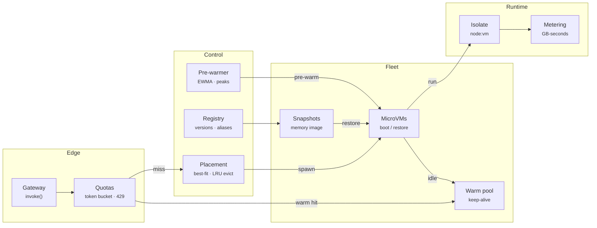

# Prism FaaS — Architecture

Serverless platforms live or die by cold starts. Every request that misses a warm sandbox pays for a VM boot, runtime init and code load. Prism FaaS models the moving parts that AWS Lambda, Fly Machines and Cloud Run tune: where sandboxes are placed, how long they stay warm, when to restore from a snapshot instead of booting, how to pre-warm ahead of traffic, and how to protect tenants from each other.

## System diagram

## How it works

1. **Deploy** — Register a function with runtime, memory, timeout and concurrency. A snapshot of the initialised VM is captured shortly after.
2. **Route** — Each invocation passes the tenant rate limiter and three concurrency gates, then looks for a warm idle VM of the current version.
3. **Start** — With no warm VM, the orchestrator places a new MicroVM best-fit (evicting LRU idle VMs if needed) and pays a cold or restore start.
4. **Execute** — The handler runs with `(event, context)`. Duration is capped by the timeout (504), and exceptions become 500s.
5. **Scale** — Every 500ms, keep-alive expiry reclaims idle VMs and the predictor tops up the warm pool from the arrival rate and peaks.

## Design decisions

- **Event-driven virtual clock.** A timer heap drives boots, executions and expiries, so a minute of bursty traffic simulates in milliseconds and tests are deterministic.
- **MRU reuse, LRU eviction.** Reusing the most recently used warm VM concentrates load and lets the rest expire. Evicting the least recently used idle VM frees memory with the least expected loss.
- **Best-fit packing** keeps large holes open for big functions (a 1.5 GB Java VM) instead of fragmenting every host.
- **Predictive pool sizing** uses Little's law (concurrency ≈ arrival rate × service time) on a decaying peak rate, so recurring bursts land on warm VMs.
- **Isolation by default.** The Node runner disables `eval` and `new Function` inside the sandbox and enforces a CPU timeout.

## Production notes

This is a faithful control-plane model, not a hypervisor. To make it real:

- Replace `spawn()` with Firecracker's API (`PUT /machine-config`, `/boot-source`, `/actions`) or Fly Machines/Cloud Run, and `restore` with Firecracker snapshot load.
- Put the router behind a real HTTP gateway and keep warm-pool state in Redis for multi-node control planes.
- Use cgroups/seccomp in each MicroVM. `node:vm` is a convenience isolate, not a security boundary against hostile code.
- Export GB-second metering to your billing pipeline.
